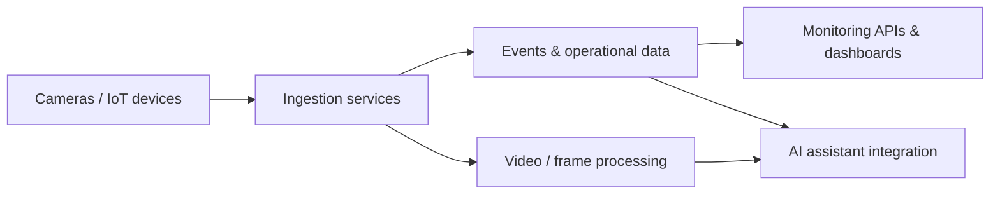

# G. Selva Ganabathi

**Principal Backend Engineer · Distributed Systems Architect · AI & IoT Platforms**

📍 Bengaluru, India &nbsp;|&nbsp; 🌍 Open to India-remote and international opportunities  
✉️ [selvagee@gmail.com](mailto:selvagee@gmail.com) &nbsp;|&nbsp; [GitHub @selvagee](https://github.com/selvagee)

---

### I build systems that connect devices, data, video and people.

Hands-on software engineering leader with **18+ years in software delivery** and **11+ years in web/backend development**. My experience spans enterprise monitoring platforms, distributed event processing, real-time CCTV/NVR integrations, and AI-assisted operational workflows.

I work across system design, implementation, production diagnostics and cross-functional technical leadership.

### Engineering focus

| Area | Technologies & experience |
| --- | --- |
| **Backend & APIs** | Node.js, Express, Python, FastAPI, Go, REST, WebSockets, Socket.IO |
| **Distributed systems** | Redis, RabbitMQ, MQTT, MySQL, MongoDB, event-driven workflows |
| **Video & IoT** | RTSP/RTMP, FFmpeg, CCTV/DVR/NVR, stream health, frame extraction, telemetry |
| **AI integration** | Ollama, MCP, RAG, LangGraph, computer-vision inference integration |
| **Delivery & operations** | Linux, AWS EC2, Docker, PM2, monitoring, incident troubleshooting |
| **Web applications** | React, Redux, JavaScript, enterprise dashboards |

### Selected engineering work

#### Multi-site surveillance and IoT operations
Designed and delivered backend capabilities for remote site monitoring: alarm ingestion, camera/device health, trouble tickets, customer access and operational reporting.

**Stack:** Node.js · Express · MySQL · Redis · Socket.IO · RTSP

#### Go / FFmpeg video capture pipeline
Worked on multi-camera RTSP stream processing with segmented recording, periodic frame extraction, retry and cooldown handling, and metadata delivery to downstream systems.

**Stack:** Go · FFmpeg · RTSP · Redis · Linux

#### AI operations assistant — prototype / integration work
Explored natural-language access to site, camera and alarm information using approved backend tool calls, local LLMs and retrieval-based workflows. This is described as prototype/integration work, **not a claimed production-scale agent deployment**.

**Stack:** Python · FastAPI · Ollama · MCP · RAG · LangGraph

#### Edge AI and computer-vision integration
Integrated image/video analytics events—including person and helmet detection, camera masking and video loss—into monitoring and alert workflows.

**Stack:** Python · FastAPI · CCTV/NVR · edge inference

### How the systems fit together

*Conceptual portfolio architecture illustrating the kinds of components I work with; not a diagram of any customer's production deployment.*

### What I bring to a team

- **Hands-on architecture:** APIs, service boundaries, event processing, data models and integrations.
- **Production ownership:** troubleshooting streaming failures, device connectivity, queue processing, database and Linux service issues.
- **Cross-functional delivery:** technical leadership across backend, frontend, mobile, infrastructure and AI integration.
- **Practical AI adoption:** adding LLM and computer-vision capabilities to existing systems without overstating their maturity.

### Roles I'm interested in

**Principal / Staff Backend Engineer** · **Distributed Systems Architect** · **Video Infrastructure Engineer** · **IoT / Edge AI Architect** · **AI Platform Integration Engineer**

### Portfolio transparency

Some of my strongest work was developed for employers and customers and is not public. I will link **independently created, sanitized demonstration repositories** here as they become available. No private customer source code or credentials are represented as public work.

---

📬 **Contact:** [selvagee@gmail.com](mailto:selvagee@gmail.com)

<!-- Future: add verified public demos, LinkedIn profile, and public resume URL after review. -->
