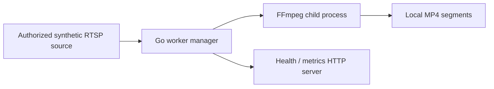

# Go RTSP Worker — independent public demo

A small, standard-library-only Go worker manager that runs FFmpeg for RTSP streams, records time-based MP4 segments, retries failed processes with bounded backoff, and exposes health/metrics endpoints.

**Status:** runnable code and unit tests; not yet tested against a real or synthetic RTSP server in this environment. This is an educational demonstration, not production-ready surveillance software.

## Requirements
- Go 1.22+
- FFmpeg installed and in PATH
- An **authorized, synthetic** RTSP test source (for example, one you host locally)

## Run

```bash
cd demos/go-rtsp-worker
go test ./...
go run ./cmd/rtsp-worker -streams 'rtsp://127.0.0.1:8554/test' -output ./segments -listen 127.0.0.1:9090
curl http://127.0.0.1:9090/healthz
curl http://127.0.0.1:9090/workers
curl http://127.0.0.1:9090/metrics
```

To stop: Ctrl+C. Segment durations depend on source keyframe intervals when using stream copy.

## Architecture



## Scope and limitations
- One process per stream; duplicate names rejected.
- Bounded exponential retry with jitter; retry counter and state snapshots.
- Graceful shutdown via Go context and FFmpeg child-process cancellation.
- HTTP binds to loopback by default; no authentication on metrics endpoints.
- Stream URLs may include credentials; **do not commit them or expose process arguments on shared hosts**.
- No frame extraction, dynamic stream configuration, retention policy, distributed orchestration, or production benchmarking yet.
- Do not use customer cameras, production IP addresses, or proprietary code in this demo.

## License
MIT; see LICENSE.
