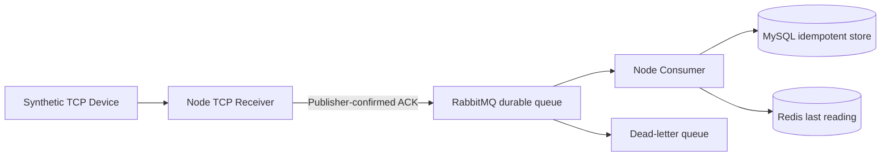

# Node.js IoT Event Receiver — synthetic portfolio demonstration

A small event-driven TCP receiver using Node.js, RabbitMQ, MySQL, and Redis. **No customer protocol, credentials, or production data included.**

## Architecture



## Start locally

Requires Node.js 20+, npm, Docker Compose and a TCP client such as `nc`.

```bash
cd demos/node-iot-event-receiver
docker compose up -d
npm install
npm test
# Separate terminals:
npm start
npm run worker
# Send synthetic packet (the ACK confirms broker publication, not database storage):
printf '@,device01,event001,26.4,1,#\n' | nc 127.0.0.1 7070
# Inspect MySQL:
docker compose exec mysql mysql -uiot -piot iot -e 'SELECT device_id,event_id,temperature,alarm FROM telemetry;'
```

The demo assumes local Docker services have started; retry `npm start` if RabbitMQ is still initializing.

## Design decisions

- Demo protocol is `@,deviceId,eventId,temperature,alarm,#` with newline-delimited packets. This is **not** a real customer protocol.
- The receiver ACKs **after RabbitMQ publisher confirmation**, not immediately on TCP receipt. This avoids falsely acknowledging events before durable enqueue. A production implementation must choose an explicit device-level acknowledgement contract.
- The MySQL unique `event_hash` provides idempotent storage for repeated `(deviceId,eventId)` events.
- Redis cache updates are best-effort and expire after one hour.
- Invalid packets receive NACK; consumer failures go to a dead-letter queue for manual inspection. A production system should classify transient versus permanent failures and implement delayed retry queues.
- Local ports bind to loopback. Docker credentials are **demo-only** and must not be reused in deployment.

## Known limitations

- Not yet executed end-to-end against Docker in this environment; only protocol unit tests and syntax checks are available.
- No TLS, authentication, schema versioning, message signature, device provisioning, replay protection, monitoring or HA.
- TCP receiver buffers newline-delimited messages and queues operations per connection; not designed for unlimited concurrent devices or slow-broker backpressure.
- Redis cache may lag or be out of order for duplicate events.
- This repository is educational and **not production-ready**.
