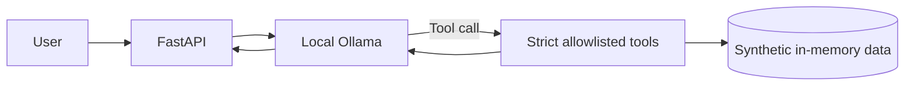

# Python IoT Operations Assistant — synthetic demo V1

Read-only FastAPI + Ollama tool-calling example for synthetic site, device and alarm information. No private customer records, network credentials or production APIs.

## Architecture



## Requirements

Python 3.10+, local Ollama with a tool-capable model (for example `qwen2.5:3b`). No cloud API key required. Model support for tool calls depends on the installed Ollama/model version.

```bash
cd demos/python-iot-ops-assistant
python3 -m venv .venv
source .venv/bin/activate
pip install -r requirements.txt
pytest -q
ollama pull qwen2.5:3b
uvicorn app.main:app --host 127.0.0.1 --port 8090
```

In a second terminal:

```bash
curl http://127.0.0.1:8090/healthz
curl http://127.0.0.1:8090/api/sites/DEMO001
curl -X POST http://127.0.0.1:8090/api/ask -H 'content-type: application/json' -d '{"question":"Is DEMO002 online and are there active alarms?"}'
```

The `/api/ask` endpoint requires Ollama running at `http://127.0.0.1:11434` by default. Override with `OLLAMA_URL` and `OLLAMA_MODEL`.

## Safety and limitations

- Only three **read-only** tool names are allowed; synthetic site IDs must match `DEMO###`.
- No real device control, external customer data, database connections or privileged actions.
- Model output is not guaranteed accurate; inspect `tool_calls` in responses to verify grounding.
- Up to four tool-call rounds, at most three calls processed per round; calls beyond that limit are ignored.
- This is a portfolio demo, **not production-ready**: no authentication, request rate limiting, audit persistence, observability or multi-tenant authorization.
- Tests validate deterministic tools and HTTP endpoints without Ollama; actual Ollama inference is not verified by these tests.
