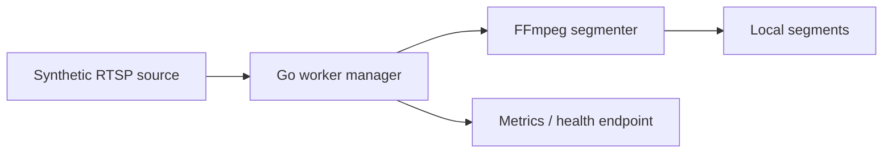

# Go RTSP Worker — proposed demo

**Status: design specification; not a runnable project yet.**

## Goal
Demonstrate lifecycle management of independent camera workers, rather than publish customer surveillance code.

## Planned implementation
- Configured synthetic stream URLs, never embedded passwords.
- One worker per stream; state machine: stopped, starting, running, retrying, cooldown.
- Context cancellation and graceful FFmpeg process shutdown.
- Bounded worker concurrency, exponential backoff and jitter.
- Segmented MP4 recording and optional periodic JPEG extraction.
- Prometheus metrics for restarts, failures, uptime and active workers.

## Acceptance tests
1. Starting the same stream twice does not duplicate the process.
2. Killing FFmpeg triggers a bounded retry.
3. Shutdown leaves no orphaned FFmpeg child.
4. A broken stream cannot starve healthy workers.

**No production-scale performance claims until measured.**
