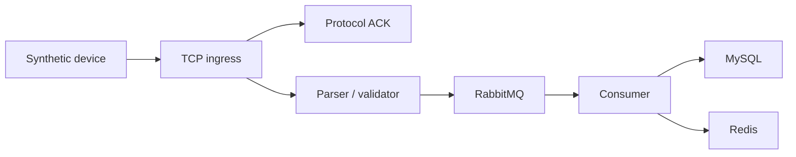

# Node.js Event Receiver — proposed demo

**Status: design specification; not a runnable project yet.**

## Goal
Build a synthetic IoT event receiver that acknowledges a device packet before asynchronous processing.

## Planned implementation
- Node.js TCP server and versioned comma-separated sample protocol.
- Fast protocol-specific ACK and bounded input parsing.
- Durable RabbitMQ queues, explicit acknowledgments and dead-letter handling.
- Idempotency keys for retries; transactional MySQL persistence.
- Redis cache for latest synthetic device state.
- Structured JSON logs, Prometheus metrics, health/readiness endpoints.
- Docker Compose for local services.

## Acceptance tests
- Valid packet receives ACK and is persisted.
- Duplicate event does not duplicate the database record.
- Invalid packet is rejected without crashing the receiver.
- Consumer restart does not silently lose an unacknowledged message.
- Queue overload has an explicit backpressure strategy.
