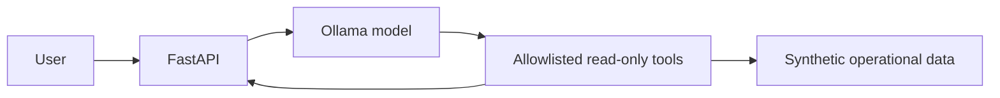

# Python Operations Assistant — proposed demo

**Status: design specification; not a runnable project yet.**

## Goal
Show safe, read-only question answering over **synthetic** site, camera and alert data using a local language model.

## Planned implementation
- FastAPI endpoints and local Ollama integration.
- Typed read-only tools: site details, camera status, active alarms, ticket count.
- Strict site ID validation and role-scoped tool authorization.
- Deterministic synthetic fixtures; no real customer records.
- Tool-call trace and latency logging with sensitive-field redaction.
- Tests for invalid IDs, unauthorized tool requests and hallucination-resistant responses.

## Acceptance tests
1. Known synthetic site produces grounded status with source references.
2. Unknown site is reported as unknown, not invented.
3. Unauthorized tool calls are denied and audited.
4. Model outage returns a controlled error without leaking internal details.
5. No mutating tools are exposed in the demonstration.
